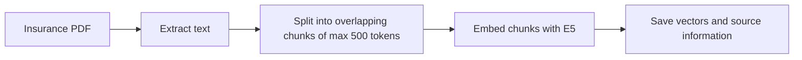
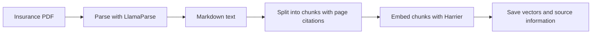
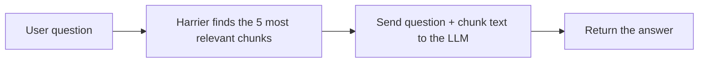
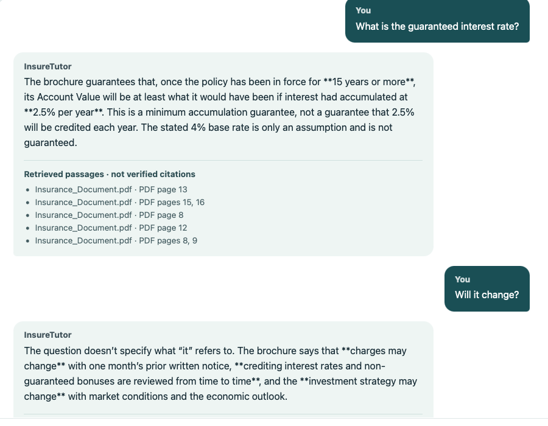
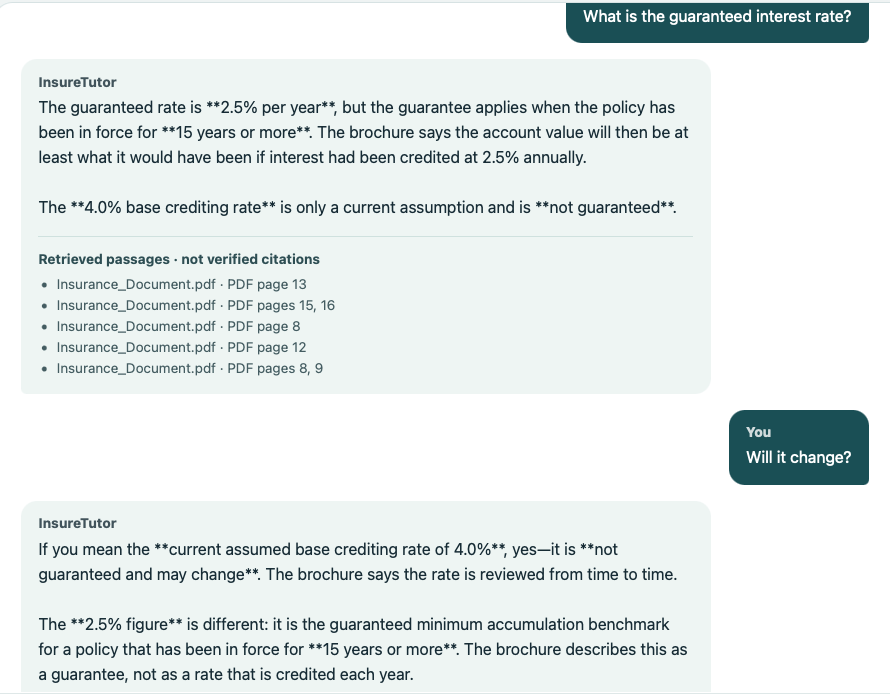
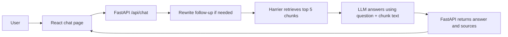

# InsureTutor

AI Usage: I will not pretend like I understand every single line of code that was written with Codex,
but I have learnt and understood this RAG pipeline and the high level details and decisions that is written below
in this README.

## Document Processing

The document given `Insurance_Document.pdf` is in this folder.  
The e5 folder represents the first attempt in creating the retrieval pipeline.  
The harrier folder represents the second attempt which resulted in much better results.

## e5 Pipeline



After learning that the general flow for retrieval is that we need to extract the text from the PDF in order to chunk and embed it, I first used the `PyMuPDF` library to save every pages detail into `extracted_pages.jsonl`.

Next step would be chunking so that instead of sending the entire PDFs detail to the LLM, we only retrieve the top 5 chunks that are related to the question. Initially I chunked in blocks of 1000 characters, but the e5 model only accepts up to 500 tokens, and some of the chunks were exceeding the limit. 

So instead in `embed_chunks.py` we chunked in blocks of 500 tokens instead, the first 50 tokens being from the previous sentence to try and keep some context in case insurance policy details overflow to multiple pages, and the rest 450 tokens on the page details itself. This produces `chunks.jsonl`.

Now we can move on to embedding it in `embed_chunks.py`, turning the text into vectors and afterwards we can use the e5 model to compare the similarity with a user's question and what chunk of information is more relevant. This produces `embeddings.npy` and also `embedding_manifest.json` which matches the saved vectors to the right chunk so that we can retrieve the chunk, get it's plain text, and send it to the LLM along with the question.

`retrieve.py` is the mini CLI program which takes in the question, compares to the chunk embeddings, and return the top 5 similar ones so that we can send it to the LLM.

### Results

When I tried it out, it seemed pretty bad, it wasn't retrieving the right information like when I asked about surrender charges and overall it wasn't very good, and instead of continuing to implement the LLM, I looked for a way to improve the retrieval first.

## What to do?

Thanks to r/RAG on reddit, I learned that there are better embedding models such as [harrier](https://huggingface.co/microsoft/harrier-oss-v1-270m) by Microsoft, and also better tools to extract texts from PDF such as [LlamaParse](https://www.llamaindex.ai/llamaparse), a caveat though is that it requires you to upload your PDF to their website, and also there's a free tier of 10,000 credits per month. So sensitive documents might not be able to use this method, instead you can opt for better open-source parsing tools such as [opendataloader-pdf](https://github.com/opendataloader-project/opendataloader-pdf)

## harrier Pipeline



So now with the parsed pdf `Insurance_Document.md` we can try and improve our results from e5.

Chunking is done in `chunk_markdown.py` where I chunk every single page itself, with `harrier` it's max token is 32,000 so I did not see any issue in doing this. This produces `harrier_chunks.jsonl`.

Aferwards we embed using the `harrier` model in `embed_harrier.py` which produces the vectors file `harrier_embeddings.npy` and also `harrier_embedding_manifest.json` which points each vectors into the correct chunk so we can retrieve the plain text later.

`retrieve_harrier.py` is the test file where I ask it a question and it returns the top 5 most relevant chunks, and it seemed to work pretty well with questions that e5 had struggle with, so moving on I integrated the LLM.

## LLM



`rag_answer.py` is the file which when given a question, it will retrieve the top 5 chunks in plaintext, then afterwards with the question, send it to a LLM model, in my case OpenAI's `gpt-6-luna`. The prompt is written in the file as well as simple guardrails to to make sure if it doesn't have enough information, it doesn't create false information, and also to ignore unrelated questions.

### Small issue



One thing I realised is that each question is individual, so if users ask a follow-up question, the LLM might not understand it well, to fix this we save the previous <=2 questions and answers, and sends a request to the LLM to rewrite the new question, if it is not related the AI will not rewrite it and just return it unchanged.

Then similarly if it was written, we send the new question to harrier, get the top 5 chunks and package it with the question and send it to the LLM for an answer.

A problem that I can see here that instead of 1 request each time, now we have to send 2 requests to the LLM which can get pricey overtime. A fix could be that when asking the AI to rewrite the question, we can use a cheaper model and when sending it to ask the actual question we can use the better models.



## Final touches



Now that the overall RAG pipeline works we have written a simple frontend using `React`, `Vite`, and `FastAPI` in the `frontend` folder.


## How to run the project

### Docker (recommended)

Install and start Docker with Compose. From the repository root, copy the
environment template and fill in your LLM provider's base URL, API key, and
model name in `.env`:

```bash
cp .env.example .env
```

The required settings are `LLM_BASE_URL`, `LLM_API_KEY`, and `LLM_MODEL`. Build
and start the complete app:

```bash
docker compose up --build
```

Open `http://localhost:8000`. The first build needs internet access to install
dependencies and download the pinned Harrier model. Answering questions also
needs access to the configured LLM provider. Docker builds the React frontend
and runs it with the FastAPI backend, so no local Python or Node installation
is needed. The `.env` file is passed to the container at runtime and is excluded
from the image.

Press Ctrl+C to stop the app. To remove the stopped container and its Compose
network, run `docker compose down`. Later starts can use `docker compose up`
without rebuilding unless you change the code or dependencies.
